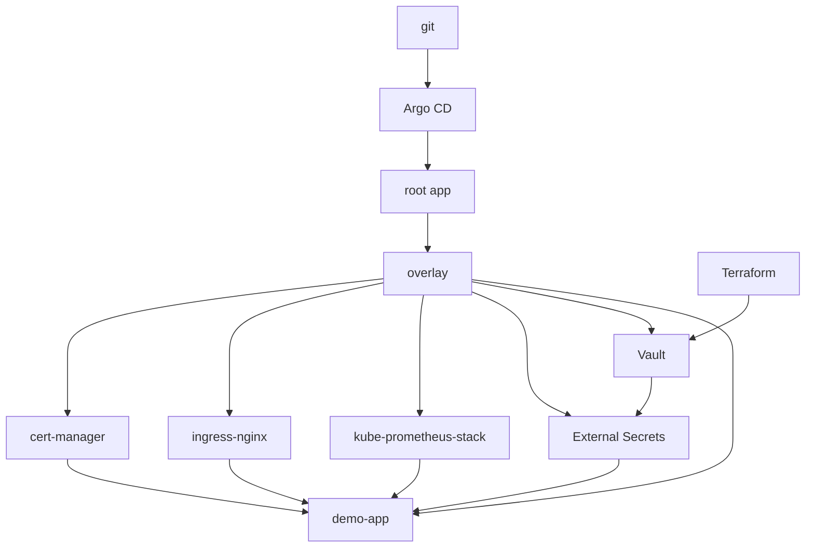

# k8s-platform-gitops

I keep this as a local lab for the GitOps setup I use day to day. Argo CD app-of-apps, pinned Helm charts, cert-manager, Vault with External Secrets, and Prometheus. It runs on kind.

Nothing in here is from an employer. The prod overlay is a second set of values, not a cluster I run.

## Quickstart

Docker, kind, kubectl, make. Ports 80 and 443 on the host need to be free.

```bash
make cluster-up
make bootstrap
kubectl -n argocd get applications
```

`make bootstrap` installs Argo CD v3.5.4 and applies `clusters/dev/root-application.yaml`. That root app tracks `master` on this repo and syncs `apps/overlays/dev`. Prod is the same apps with automated sync turned off, and it uses the prod values files. Run one environment per cluster. The Application names are the same, so they collide.



Argo CD UI:

```bash
kubectl -n argocd port-forward svc/argocd-server 8080:443
kubectl -n argocd get secret argocd-initial-admin-secret \
  -o jsonpath='{.data.password}' | base64 --decode; echo
```

`https://localhost:8080`, user `admin`.

Grafana reads its admin password from a Secret I create in the cluster, not from git:

```bash
kubectl -n monitoring create secret generic grafana-admin \
  --from-literal=admin-user=admin \
  --from-literal=admin-password="$(openssl rand -base64 18)"
kubectl -n monitoring port-forward svc/kube-prometheus-stack-grafana 3000:80
```

The demo Ingress is `https://demo.127.0.0.1.nip.io`. The cert comes from the local `platform-ca` issuer (`ca.crt` in the `platform-ca` Secret, namespace `cert-manager`), so a browser will not trust it until you do.

Vault on the dev overlay is the chart's dev server. Token is `root`. Data goes away when the pod restarts. Terraform creates the KV mount and the Kubernetes auth role. See [terraform/README.md](terraform/README.md). After apply:

```bash
export VAULT_ADDR=http://127.0.0.1:8200
export VAULT_TOKEN=root
vault kv put platform/demo-app/config api-token=local-demo
```

External Secrets copies `api-token` into `demo-app-secrets`. The pod mounts that Secret only when it exists.

Right-sizing, once Prometheus is up. There is no metrics-server in this lab, so the script talks to Prometheus:

```bash
kubectl -n monitoring port-forward svc/kube-prometheus-stack-prometheus 9090:9090
python3 scripts/rightsizing.py --prometheus-url http://127.0.0.1:9090
```

Offline: `python3 scripts/rightsizing.py --fixture scripts/testdata/pods.json`.

Loki is optional and not in the root app. `kubectl apply -f apps/optional/loki.yaml`, then sync it in Argo CD.

`make down` deletes the cluster. `make lint` is what CI runs.

Forks need their own `repoURL` and `targetRevision`.

## Layout

```text
apps/           app-of-apps. dev syncs itself, prod does not
clusters/       root Application, one file per environment
platform/       Helm values, issuers, alerts, Vault RBAC
charts/demo-app sample workload
terraform/      Vault KV mount and Kubernetes auth
scripts/        bootstrap, render, rightsizing report
deploy/kind     kind cluster (node v1.35.8)
```

Chart pins live on the Applications: cert-manager v1.21.2, ingress-nginx 4.15.1, kube-prometheus-stack 92.1.0, external-secrets 2.12.0, vault 0.34.1, loki 7.3.0. `scripts/render.sh` refuses to template if those pins drift. The demo image is `ghcr.io/stefanprodan/podinfo:6.15.0`.

Sync waves are on the Applications. CRDs (Prometheus operator, cert-manager, External Secrets) land before the issuers, the ExternalSecret and the demo app.

## Notes

Secrets stay out of git. Terraform creates the mount, the policy and the role. The reviewer JWT and the CA are variables. Grafana uses `existingSecret`.

Dev Vault is dev mode. Prod values are one replica, file storage, chart default listener with TLS off, and you still have to init and unseal it yourself.

Prometheus selects rules and ServiceMonitors in every namespace. The cert alerts are `CertificateExpiringSoon` (14 days) and `CertificateExpiringCritical` (3 days). The dashboard ConfigMap is picked up by the Grafana sidecar (`grafana_dashboard=1`).

demo-app runs as uid 100, read-only rootfs, all capabilities dropped, requests and limits set, two replicas. The PDB is `maxUnavailable: 1`. The NetworkPolicy only allows ingress from `ingress-nginx` and `monitoring`, and egress to CoreDNS. Requests are small so the rightsizing script has something to complain about. CPU limits are there too. They can throttle. Memory limits are the ones that matter for the node.

kind is 1.35.8 because ingress-nginx 4.15.1 only supports up through 1.35. That chart is the last release. The upstream repo was archived in March 2026. I still use it here for the host-port setup on kind.

On OpenShift I would use a Route instead of ingress-nginx (the controller wants host ports and will not sit in restricted-v2). I would not install kube-prometheus-stack next to cluster monitoring. The demo securityContext matches restricted-v2. Set `global.openshift` on the Vault chart if you actually run it there. cert-manager and External Secrets are unchanged.

The `platform` AppProject allows every cluster-scoped kind. The charts install CRDs and webhooks. On a real cluster I would list the kinds instead.

## License

MIT. See [LICENSE](LICENSE).
